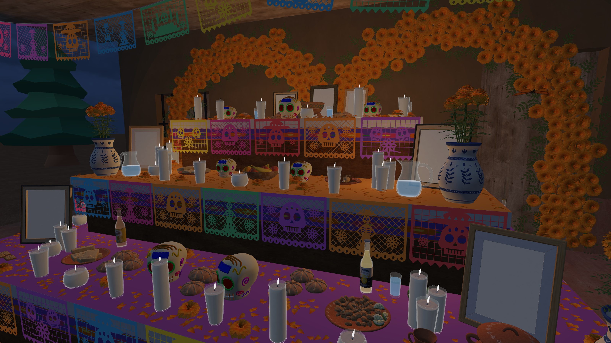
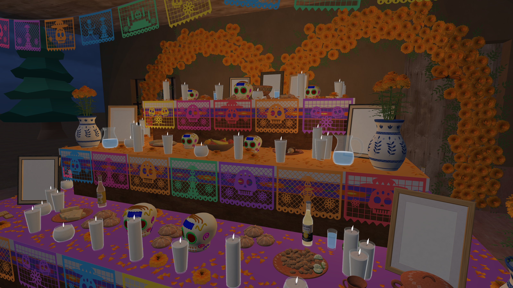

# Altar: rendimiento e iluminación OpenGL

Rama `optimizacion/altar-luces`. La carpeta original `texturizado-entrega` sigue en `main`, con sus cambios locales intactos. Esta carpeta es un worktree independiente. El punto de partida completo está guardado en `respaldo/estable-antes-optimizacion` (commit `419fec1`). No se fusionó ni publicó la rama.

## Probar

Abrir `ejecutables/macOS/TexturizadoCempasuchil-0.2.1.app` **desde esta carpeta**. El lanzador compila su propia copia. Pulsar **I** para alternar el relleno cálido del altar; no desactiva las luces originales. Se conservan los controles anteriores, incluyendo F para la linterna.

Todo se ilumina en OpenGL. No hay luz horneada, texturas nuevas de iluminación, modelos simplificados, reducción de resolución ni cambio de MSAA (continúa 4×).

## Cambios

1. Cada primitiva recibe solo las luces cuyo volumen de alcance intersecta su caja mundial. Para lotes se usa la caja de todas sus instancias, de forma conservadora. Se preservan el orden, intensidad, atenuación y límites de la lista original. Las cajas se recalculan a partir de las transformaciones actuales, incluyendo las mariposas animadas.
2. Los materiales con transmisión total ya reemplazaban el resultado iluminado por su fórmula de vidrio. Ahora se omiten los cálculos puntuales cuyo resultado se descartaba. Los materiales opacos no calculan Fresnel/transparencia. Una luz detrás de la normal omite cálculos de difuso y especular que necesariamente valen cero.
3. Los dibujos consecutivos con el mismo material/programa reutilizan sus uniformes y texturas. La caché se invalida cada cuadro y después del skybox.
4. Se añade una luz cálida, frontal y elevada, que representa un relleno suave del altar. Esta fuente utiliza un espacio adicional y **no desplaza ninguna de las 24 luces originales posibles**. Se apaga con I o `--luz-original`.

Esto no da una lámpara a cada objeto ni convierte los materiales en emisores: todos siguen respondiendo a las luces de OpenGL. El filtrado reduce la lista que cada objeto debe evaluar. El shader original hacía el trabajo principalmente por fragmento/píxel, no por vértice.

## Medición en Apple M1 Pro

Framebuffer real 3200×1800 (ventana lógica 1600×900 en Retina), MSAA 4×, 8 cuadros de calentamiento y 40 muestras por vista, sincronización de GPU con `glFinish`, sin VSync. La cámara, modelos, materiales y geometría son iguales. Las animaciones se mantienen en reposo para comparar exactamente el mismo cuadro. No son garantías de FPS durante un recorrido; influyen la carga y temperatura del equipo.

| Vista | Estable | Optimizada, luz original | Optimizada, relleno cálido |
|---|---:|---:|---:|
| Detalle altar | 29.3 FPS / 34.10 ms | 60.3 FPS / 16.57 ms | 57.8 FPS / 17.31 ms |
| Altar | 30.7 FPS / 32.59 ms | 70.6 FPS / 14.17 ms | 69.0 FPS / 14.49 ms |
| Camino | 42.8 FPS / 23.38 ms | 77.2 FPS / 12.95 ms | 69.2 FPS / 14.45 ms |
| Vista general | 63.7 FPS / 15.69 ms | 88.3 FPS / 11.32 ms | 84.4 FPS / 11.84 ms |

El detalle del altar conserva 4,570,348 triángulos y 609 llamadas de dibujo. Las 7 vistas se dibujaron sin errores de OpenGL. Datos completos en `rendimiento/mediciones.json`.

## Conservación visual

Comparación con el ejecutable estable, sin el nuevo relleno: 5 vistas idénticas píxel por píxel; en detalle cambió 1 canal por 1/255, y en panteón cambiaron 3 canales con diferencia máxima 4/255. Cada imagen tiene 17,280,000 canales. Estas diferencias residuales son compatibles con redondeo de shader y no representan pérdida de objetos, texturas o detalle. Resultados en `rendimiento/comparacion-pixeles.json`.

Antes:



Después, con relleno OpenGL:



## Diagnóstico reproducible

Con el ejecutable compilado y sus recursos:

```sh
./TexturizadoCempasuchil --diagnosticar-rendimiento --captura /tmp/altar.ppm
./TexturizadoCempasuchil --diagnosticar-rendimiento --luz-original
./TexturizadoCempasuchil --diagnosticar-rendimiento --luz-original --sin-filtro-luces
```

`--vista N` después de `--diagnosticar-rendimiento` selecciona las vistas 0–6. El último comando desactiva el filtrado de luces, pero conserva las otras optimizaciones del shader; no sustituye a ejecutar el commit estable para una comparación completa. La captura PPM corresponde al primer ensayo, con luces activas. Las pruebas posteriores sin luces y sin MSAA son solamente mediciones y no cambian la configuración del siguiente arranque.

## Opciones futuras

Si aún hace falta rendimiento: dividir los lotes grandes por zonas para descartar instancias fuera del encuadre; usar listas de luces por bloques de pantalla; o crear versiones de menor detalle para objetos lejanos. Reducir las mallas cercanas o el MSAA cambiaría la imagen, por eso no se aplicó en esta versión. Las sombras dinámicas exigirían mapas de sombras y presupuesto adicional de GPU; el relleno actual no añade sombras nuevas.
